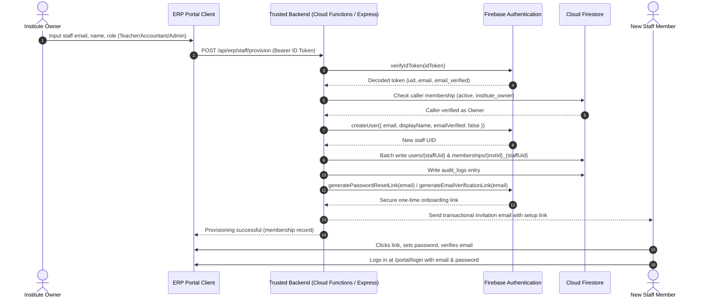

# Trusted Backend Provisioning & Identity Architecture — Pradeep Classes ERP

## 1. Executive Summary & Environment Analysis

- **Application Stack**: React 19, TypeScript, Vite, Tailwind CSS 4, React Router 7, Firebase Authentication (v12), Cloud Firestore.
- **Current Firebase Project**: `gen-lang-client-0277566445` (Firestore database: `ai-studio-e49bdfd8-185d-4071-a5dc-e984b04839e2`).
- **Environment Limitation (Starter Tier / Google-Hosted Project)**:
  - Google-hosted Starter Tier projects provisioned through AI Studio do **not** provide user-managed GCP Cloud Billing, IAM role grants (`roles/firebaseauth.admin`, `roles/datastore.user`), or Cloud Functions deployment permissions for the application runtime service account.
  - Calling `firebase-admin` server-side Firestore reads/writes (`db.doc(...)`) or Firebase Auth user-management APIs (`admin.auth().createUser`, `setCustomUserClaims`, `revokeRefreshTokens`, `generatePasswordResetLink`) from a local Express server without service account credentials fails with `7 PERMISSION_DENIED` / HTTP 403.
  - **Security Mandate**: Service account JSON private keys are deliberately **excluded** from this repository, build artifacts, and client/server bundles. Client-side code is never trusted to self-assign roles or call privileged provisioning APIs.
- **Firebase Console Auth Prerequisite (Email/Password)**:
  - The AI Studio Firebase provisioning flow enables Google Sign-In by default for the legacy CMS (`/admin/login`).
  - For `/portal/login`, the project owner must enable **Email/Password** in Firebase Console:
    `Authentication -> Sign-in method -> Email/Password -> Enable -> Save`.
  - Until enabled, `signInWithEmailAndPassword` returns `auth/operation-not-allowed`.

---

## 2. Supported Production Provisioning Architecture (Blaze / Cloud Functions v2)

Once the project owner connects a user-owned Firebase/GCP project on the **Blaze** plan (or attaches an authenticated backend with a service account holding `roles/firebaseauth.admin` and `roles/datastore.user`), all staff lifecycle operations run exclusively through trusted HTTPS Callable / Express endpoints authenticated via `admin.auth().verifyIdToken(idToken)` and verified against Firestore `institutes` and `memberships`.



---

## 3. Detailed Staff Lifecycle Specifications

### A. One-Time Owner Account Initialization (`bootstrapInstituteOwner`)
1. **Trigger**: Executed once during institute onboarding via an idempotent CLI administrative script or protected backend setup endpoint gated by an environment bootstrap secret (`BOOTSTRAP_SECRET`) and restricted to the super-admin email allowlist (`sumitdevthakur@gmail.com`, `pradeepclasses.in@gmail.com`).
2. **Identity Creation**:
   - Creates or fetches the Owner's Firebase Auth record (`email`, `displayName`, `emailVerified: true`).
3. **Atomic Firestore Initialization**:
   - In a single Firestore atomic batch or transaction:
     - `institutes/{instituteId}`:
       ```json
       {
         "name": "Pradeep Classes",
         "code": "PC01",
         "status": "active",
         "ownerUid": "owner_uid",
         "academicSession": "2026-2027",
         "timezone": "Asia/Kolkata",
         "createdAt": "2026-01-01T00:00:00.000Z",
         "updatedAt": "2026-01-01T00:00:00.000Z"
       }
       ```
     - `users/{ownerUid}`:
       ```json
       {
         "uid": "owner_uid",
         "email": "owner@pradeepclasses.in",
         "displayName": "Pradeep Thakur",
         "status": "active",
         "defaultInstituteId": "inst_main",
         "createdAt": "2026-01-01T00:00:00.000Z",
         "updatedAt": "2026-01-01T00:00:00.000Z"
       }
       ```
     - `memberships/{instituteId}_{ownerUid}`:
       ```json
       {
         "id": "inst_main_owner_uid",
         "uid": "owner_uid",
         "instituteId": "inst_main",
         "role": "institute_owner",
         "status": "active",
         "displayName": "Pradeep Thakur",
         "designation": "Director",
         "createdBy": "system_bootstrap",
         "createdAt": "2026-01-01T00:00:00.000Z",
         "updatedAt": "2026-01-01T00:00:00.000Z"
       }
       ```

---

### B. Staff Account Creation & Invitation (`createStaffAccount` / `inviteStaffMember`)
1. **Authorization Gate**:
   - Caller presents a valid Firebase Auth ID Token.
   - Backend decodes token and verifies `token.email_verified === true`.
   - Backend queries `memberships/{instituteId}_{callerUid}`:
     - Must exist and have `status === 'active'`.
     - Role must be `institute_owner` OR `institute_admin`.
   - **Role Hierarchy Enforcement**:
     - `institute_owner` can create any staff role (`institute_admin`, `accountant`, `teacher`).
     - `institute_admin` can ONLY create non-owner staff (`teacher`, `accountant`).
     - `institute_admin` CANNOT create or promote anyone to `institute_owner` or `institute_admin`.
     - `accountant` and `teacher` cannot create or invite any staff.
2. **Account Provisioning**:
   - Backend checks if Auth user already exists for the email:
     - If not: calls `admin.auth().createUser({ email, displayName, emailVerified: false, disabled: false })`.
     - If exists: reuses existing `staffUid` (supporting multi-institute teachers/staff).
3. **Firestore Writes (Transaction)**:
   - Sets `users/{staffUid}` with `status: 'active'`, `email`, `displayName`.
   - Sets deterministic `memberships/{instituteId}_{staffUid}` with `status: 'active'`, `role`, `createdBy: callerUid`.
4. **Invitation Link**:
   - Backend generates an action link via `admin.auth().generatePasswordResetLink(email)` or transactional invite token.
   - Link is sent directly to the staff member's email (never logged or exposed in client responses).

---

### C. Email Verification & Password Setup
- **Initial Setup**: The invitation email directs the staff member to complete password creation.
- **Verification Gate**: Firebase Auth sets `emailVerified: true` once the verification/password action link is completed.
- **Client Enforcement**: `AuthContext.tsx` blocks access to `/portal/*` if `user.emailVerified !== true`, displaying the Email Verification Required screen with resend and verification check actions.
- **Self-Service Password Reset**: Staff members can initiate a password reset from `/portal/login` using `sendPasswordResetEmail(auth, email)`. Error messages do not leak whether an account exists.

---

### D. Membership Document Creation & Schema Constraints
All memberships must adhere to the deterministic document ID convention:
```
memberships/{instituteId}_{uid}
```
Fields:
- `id`: string (must equal `{instituteId}_{uid}`)
- `uid`: string (must match Firebase Auth UID)
- `instituteId`: string (must match parent institute)
- `role`: `'institute_owner' | 'institute_admin' | 'accountant' | 'teacher'`
- `status`: `'active' | 'suspended' | 'revoked'`
- `displayName`: string (max 100 chars)
- `designation`: string (optional, max 100 chars)
- `createdBy`: string (UID of the creator)
- `createdAt`: ISO 8601 string or Firestore ServerTimestamp
- `updatedAt`: ISO 8601 string or Firestore ServerTimestamp

---

### E. Role Assignment & Role Changes (`updateStaffMembershipRole`)
- **Authority**: ONLY an `institute_owner` of `{instituteId}` may alter a staff member's role.
- **Restrictions**:
  - `institute_admin` CANNOT alter any staff role (`staff:role:manage` is strictly denied to Admins).
  - Owner-to-Owner transfer requires a dual-authorization confirmation step to prevent accidental lockouts.
- **Transaction**:
  - Validates `memberships/{instituteId}_{targetUid}` exists.
  - Updates `role` to new valid `ErpRole`.
  - Updates `updatedAt`.
  - Appends an audit record to `audit_logs`.

---

### F. Suspension & Reactivation Lifecycle
- **Authority**:
  - `institute_owner` can suspend/reactivate any staff member.
  - `institute_admin` can suspend/reactivate `teacher` and `accountant` members. Admin cannot suspend Owners or Admins.
- **Institute-Scoped Suspension**:
  - Updates `memberships/{instituteId}_{targetUid}.status = 'suspended'`.
  - Firestore Security Rules immediately evaluate `resource.data.status == 'active'` and block all read/write operations for that institute.
- **Reactivation**:
  - Updates `memberships/{instituteId}_{targetUid}.status = 'active'`.
  - Restores institute access upon subsequent token refresh or context reload.
- **Global User Account Disablement**:
  - If a user is globally terminated, the backend sets `users/{targetUid}.status = 'disabled'` and disables the Firebase Auth record:
    ```ts
    await admin.auth().updateUser(targetUid, { disabled: true });
    await admin.auth().revokeRefreshTokens(targetUid);
    ```

---

### G. Membership Revocation Flow (`revokeStaffMembership`)
- **Authority**: ONLY `institute_owner`.
- **Action**:
  - Updates `memberships/{instituteId}_{targetUid}.status = 'revoked'`.
  - Calls `admin.auth().revokeRefreshTokens(targetUid)` to immediately invalidate active session tokens.
  - Once revoked, the membership cannot be reactivated; a new invitation and provisioning cycle is required.
  - Audit log recorded with actor UID, target UID, reason, and timestamp.

---

### H. Token Revocation & Immediate Session Termination
When an account is suspended, revoked, or globally disabled:
1. Backend issues:
   ```ts
   await admin.auth().revokeRefreshTokens(targetUid);
   ```
2. The user's ID token expires within at most 1 hour; token refresh requests will fail immediately with `auth/user-token-revoked`.
3. Firestore rules check live document status (`isActiveUserRecord()` and `isActiveInstituteMember()`) on every document access, guaranteeing zero-latency denial even during the remaining window of a cached ID token.

---

### I. Audit Logging Requirements
All staff lifecycle operations must generate an immutable audit log document in the `audit_logs` collection:
```json
{
  "instituteId": "inst_alpha",
  "action": "staff:role:changed",
  "actorUid": "uid_owner",
  "actorRole": "institute_owner",
  "targetUid": "uid_staff_01",
  "previousValue": { "role": "teacher" },
  "newValue": { "role": "accountant" },
  "ipAddress": "203.0.113.195",
  "userAgent": "Mozilla/5.0 ...",
  "timestamp": "2026-11-19T01:50:00.000Z"
}
```
- Collection rules: `allow create: if isVerifiedUser() && isInstitutePrivileged(incoming().instituteId); allow update, delete: if false;` (write-once, tamper-evident).

---

## 4. Backend Security Rules & API Validation Logic

```
┌─────────────────────────────────────────────────────────────┐
│                   Incoming HTTP/Callable Request            │
└──────────────────────────────┬──────────────────────────────┘
                               │
                [1. Validate Bearer ID Token]
                               ▼
        ┌──────────────────────────────────────────────┐
        │ Valid Token & email_verified == true?        │
        └──────────────┬───────────────────────────────┘
                       │ Yes
        [2. Query Caller Profile & Membership]
                       ▼
        ┌──────────────────────────────────────────────┐
        │ users/{callerUid}.status == 'active' &       │
        │ institutes/{instId}.status == 'active'?      │
        └──────────────┬───────────────────────────────┘
                       │ Yes
        [3. Authorize Action by Role]
                       ▼
    ┌──────────────────────┬──────────────────────┐
    │ Owner                │ Admin                │
    │ Full staff lifecycle │ Non-owner staff only │
    └──────────┬───────────┴──────────┬───────────┘
               │                      │
               └──────────┬───────────┘
                          │ Authorized
        [4. Atomic Firestore Transaction]
                          │
        [5. Revoke Tokens / Dispatch Email / Audit Log]
```

---

## 5. Client-Side Security Guarantees Already Enforced Today

1. **Zero Public Staff Registration**:
   - `createUserWithEmailAndPassword` is absent from all portal routes and auth contexts. Staff accounts can never be created through self-registration.
2. **Fail-Closed Missing User Profile**:
   - `firestore.rules` `isActiveUserRecord()` requires `exists(...) && get(...).data.status == 'active'`. Missing profiles immediately fail closed.
   - `AuthContext.tsx` sets `erpRole = null` if `!userProfile || userProfile.status !== 'active'`.
   - `PortalRoute.tsx` blocks rendering and shows "Staff Profile Not Found" fail-closed screen.
3. **Fail-Closed Missing / Suspended Institute**:
   - `AuthContext.tsx` sets `erpRole = null` if `!activeInstitute || activeInstitute.status !== 'active'`.
   - `PortalRoute.tsx` blocks rendering and shows "Institute Workspace Unavailable / Suspended".
4. **Email Verification Gate**:
   - Verified email (`emailVerified === true`) is required before resolving any ERP role or querying institute memberships.
5. **Deterministic Document IDs**:
   - Memberships use `${instituteId}_${uid}` exclusively. Rules enforce that ID matches incoming data.
6. **Immutable Key Fields**:
   - `firestore.rules` blocks modification of `uid`, `instituteId`, `createdBy`, and `createdAt` on existing memberships.
7. **Strict Cross-Institute Isolation**:
   - Membership queries must be bounded by `where('instituteId', '==', activeInstituteId)`. Unbound or cross-institute queries are rejected by security rules.
